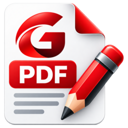

<p align="center">
  
</p>

<h1 align="center">Gera PDF Editor</h1>

<p align="center">
  Editor de PDF completo, livre e nativo para Linux, escrito em Rust.<br>
  A meta: todas as ferramentas do Acrobat Pro, com a mesma qualidade, sem custo e com código aberto.
</p>

<p align="center">
  <a href="https://github.com/junior9283/gera-pdf-editor/releases/latest"></a>
  <a href="LICENSE"></a>
  <a href="https://github.com/junior9283/gera-pdf-editor/actions/workflows/ci.yml"></a>
  
</p>

---

## Por quê

No Linux falta um editor de PDF que faça tudo o que o Acrobat Pro faz: comentar, preencher e assinar,
criar formulários, assinar com certificado digital, organizar páginas, proteger, comprimir, converter,
reconhecer texto (OCR) e editar o conteúdo. O Gera PDF Editor reúne tudo isso num só programa
**nativo, rápido e leve**:

- abre em ~120 ms;
- usa ~120 MB de memória, mesmo com 3 abas;
- binário de ~24 MB.

O comportamento e os atalhos de teclado seguem os do Acrobat, para quem vem de lá não precisar
reaprender nada. A implementação é **original**: nenhum código, ícone ou recurso da Adobe.

## Baixar e usar

1. Baixe o `Gera_PDF_Editor-x86_64.AppImage` da [última versão](https://github.com/junior9283/gera-pdf-editor/releases/latest).
2. Torne-o executável e abra:

   ```bash
   chmod +x Gera_PDF_Editor-x86_64.AppImage
   ./Gera_PDF_Editor-x86_64.AppImage arquivo.pdf
   ```

O AppImage roda na maioria das distribuições x86-64 modernas (Fedora, Ubuntu, Debian, openSUSE, Arch…)
e já traz os dados de OCR em português e inglês.

## Funcionalidades

| Área | O que já faz |
|---|---|
| **Leitura** | Abas, miniaturas, marcadores, zoom (ajustar à página/largura), página a página ou rolagem contínua, tela cheia, busca com destaque, seleção e cópia de texto, impressão, propriedades do documento |
| **Comentar** | Destacar, sublinhar, notas, desenho à mão livre, caixa de texto, retângulo, elipse, linha, seta, carimbos; tudo editável (mover, redimensionar, cor, espessura, opacidade); painel Comentários com respostas, status, filtro, ordem e busca |
| **Organizar páginas** | Reordenar arrastando, girar, excluir, extrair, inserir páginas de outro arquivo, recortar margens |
| **Dividir e combinar** | Dividir por número de páginas, por tamanho ou por marcadores; combinar vários PDFs em um |
| **Formulários** | Preencher campos (texto, caixas de seleção, botões de opção, listas); **Preparar formulário**: criar, mover e editar as propriedades dos campos |
| **Preencher e assinar** | Texto livre, marcas (✓ ✗ ●), assinatura e iniciais desenhadas, digitadas ou de imagem |
| **Certificados** | Assinatura digital com certificado (PKCS#12 ou ID digital criado no app), validação das assinaturas do documento |
| **Proteger** | Senha de abertura e de permissões (AES-256), respeito às permissões de documentos protegidos |
| **Comprimir** | Níveis baixa, média e alta: une objetos repetidos, remove os não usados e reduz a resolução das imagens |
| **Criar e exportar** | Criar PDF a partir de imagens; exportar para Word (.docx), texto ou imagens (PNG/JPEG) |
| **Digitalizar e OCR** | Reconhece o texto de páginas escaneadas (Tesseract) e o torna pesquisável e selecionável |
| **Redigir** | Marcar texto e áreas, localizar por frase ou padrões (CPF, CNPJ, telefone, e-mail, cartão, CEP, data), aplicar de forma permanente (texto, imagens, desenhos, campos, comentários e texto alternativo) e limpar o documento (metadados, anexos, scripts) |
| **Marca d'água, cabeçalho e rodapé** | Marca de texto, imagem ou página de PDF (rotação, opacidade, escala, atrás/na frente); cabeçalho e rodapé com número da página, data e numeração Bates; Atualizar e Remover (também as do Acrobat) |
| **Comparar arquivos** | Diferenças de texto (substituído, inserido, excluído), de formatação e de imagens entre duas versões; relatório PDF lado a lado com resumo, legenda e as alterações no painel Comentários; Próxima/Anterior alteração (`Ctrl+.`/`Ctrl+,`) |
| **Editar PDF** | Texto: editar no lugar com a fonte, o tamanho e a cor originais, parágrafos que refluem, adicionar texto. Imagens: mover, redimensionar mantendo a proporção, girar, substituir, adicionar e excluir. Tudo com desfazer |

Atalhos do Acrobat: `Ctrl+O`, `Ctrl+S`, `Ctrl+Shift+S`, `Ctrl+P`, `Ctrl+F`, `Ctrl+Z`/`Ctrl+Shift+Z`,
`Ctrl+=`/`Ctrl+-`, `Ctrl+0`/`Ctrl+1`/`Ctrl+2`, `Ctrl+D`, `F11`, `Ctrl+Tab` e outros. A lista completa está em
**Ajuda → Atalhos de teclado**.

## Andamento

O projeto avança em etapas. Cada etapa tem especificação, plano, testes (unidade, integração e
interface) e revisão de código independente antes de entrar na `main`.

| Etapa | Conteúdo | Situação |
|---|---|---|
| v1 | Visualizador leve com anotações | ✅ 0.1.0 |
| v1.1-A | Interface no estilo do Acrobat (abas, Ferramentas, painéis) | ✅ 0.2.0 |
| v1.1-B1 | Seleção de texto, impressão, propriedades | ✅ 0.3.0 |
| v1.1-B2 | Anotações editáveis, formas, carimbos, painel Comentários | ✅ 0.4.0 |
| v2 | Organizar páginas, dividir e combinar | ✅ 0.5.0 |
| v3 | Formulários, preencher e assinar, certificados | ✅ 0.6.0 |
| v5 | Proteger, comprimir, criar/exportar, OCR | ✅ 0.7.0 |
| v4a | Editar PDF: imagens | ✅ 0.8.0 |
| v4b | Editar PDF: texto | ✅ 0.9.0 |
| v2c | Marca d'água, cabeçalho e rodapé, Bates | ✅ 0.10.0 |
| v5e | Redigir e limpar documento | ✅ 0.11.2 |
| v5f | Comparar arquivos | ✅ 0.12.0 |
| v6a | Navegar e exibir: links, histórico, tela cheia, modo leitura, zoom até 6400 % | ✅ 0.13.0 |
| v6b | Mão, Zoom com marca, Preferências, Recortar/Colar, busca com opções, menu de contexto | ✅ 0.14.0 |
| v6c | Propriedades editáveis, painéis Marcadores e Anexos | ✅ 0.15.2 |
| v6c2 | Miniaturas, Camadas, Destinos, rótulos de página, copiar páginas entre PDFs | ✅ 0.16.0 |
| v6d–v6n | Avaliação para a 1.0.0: as lacunas restantes em relação ao Acrobat Pro | 🚧 próxima |

O histórico de cada versão está no [CHANGELOG](CHANGELOG.md) e o plano detalhado no [ROADMAP](ROADMAP.md).
As especificações e os planos de cada etapa ficam em [`docs/superpowers`](docs/superpowers).

## Compilar a partir do código

Requisitos: Rust estável recente (`rustup`), um compilador C/C++ (gcc ou clang), `make`, `cmake`, `pkg-config`,
`libclang` e os cabeçalhos de fontconfig/freetype. O MuPDF é compilado junto, estaticamente.

```bash
# Fedora
sudo dnf install gcc gcc-c++ clang-devel cmake make pkgconf-pkg-config fontconfig-devel freetype-devel
# Debian/Ubuntu
sudo apt install build-essential clang libclang-dev cmake pkg-config libfontconfig1-dev libfreetype-dev

git clone https://github.com/junior9283/gera-pdf-editor.git
cd gera-pdf-editor
cargo run --release -- arquivo.pdf
```

Outros comandos úteis:

```bash
cargo test --workspace            # todos os testes
cargo clippy --workspace --all-targets
scripts/measure.sh                # metas de desempenho (abertura, memória, binário)
packaging/build-appimage.sh       # gera dist/Gera_PDF_Editor-x86_64.AppImage
```

## Arquitetura

```
crates/
  pdf-core/   motor: abrir, desenhar, anotar, formulários, assinaturas, proteger,
              comprimir, exportar, OCR e editar (MuPDF), num worker em thread própria
  app-state/  estado e regras da interface, sem dependência de UI (testável isoladamente)
  gera-ui/    interface gráfica (egui/eframe): abas, barras, painéis e ferramentas em tela
```

## Contribuir

Contribuições são bem-vindas: relatos de bugs, sugestões, traduções, testes com PDFs reais e código.
Leia o [guia de contribuição](CONTRIBUTING.md) e o [código de conduta](CODE_OF_CONDUCT.md).
Para falhas de segurança, siga a [política de segurança](SECURITY.md).

## Licença

[GNU AGPL-3.0](LICENSE). O Gera PDF Editor usa o MuPDF (Artifex, AGPL-3.0) e outras bibliotecas
livres listadas em [THIRD_PARTY_NOTICES.md](THIRD_PARTY_NOTICES.md). Quem distribuir versões modificadas
precisa disponibilizar o código-fonte nos mesmos termos.

---

### In English

**Gera PDF Editor** is a free, open-source (AGPL-3.0), native PDF editor for Linux written in Rust,
aiming at feature and quality parity with Adobe Acrobat Pro: viewing, commenting, page organization,
forms, fill & sign, digital signatures, protection, compression, conversion, OCR and content editing.
The UI is currently in Brazilian Portuguese; contributions (including translations) are welcome — see
[CONTRIBUTING.md](CONTRIBUTING.md). Download the AppImage from the
[latest release](https://github.com/junior9283/gera-pdf-editor/releases/latest).
